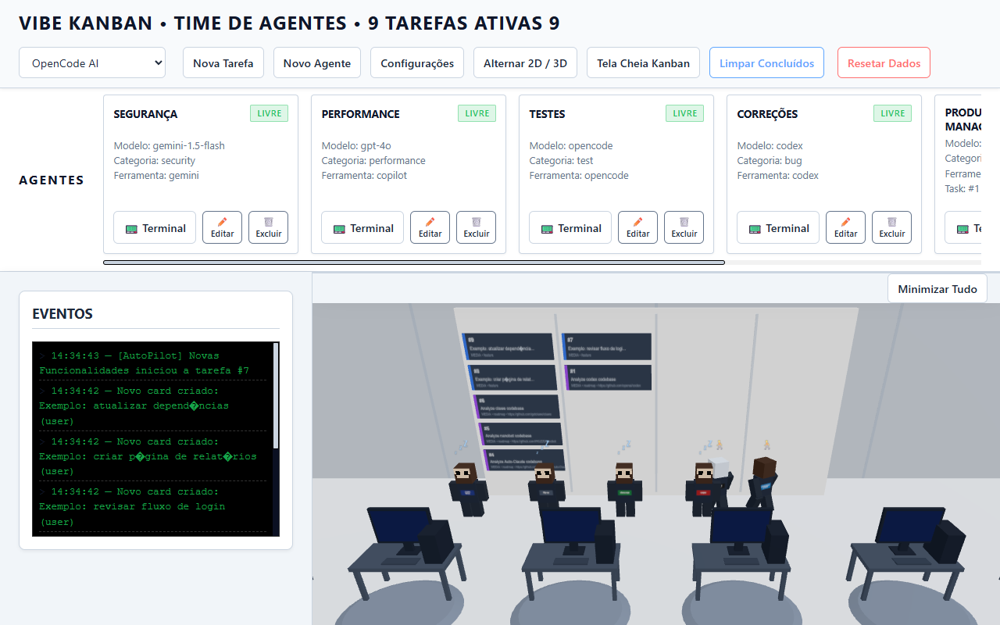
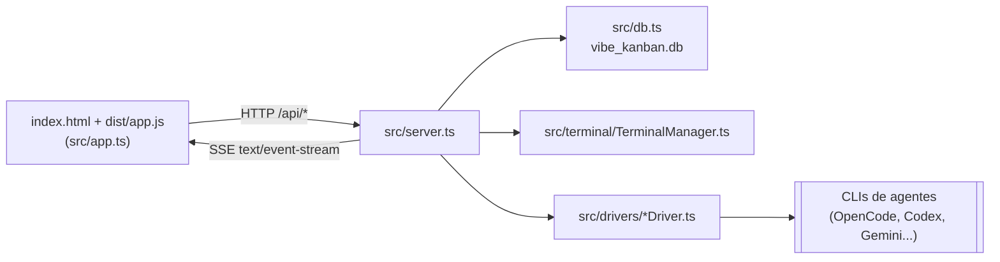

<div align="center">

# 📋 Vibe Kanban


[](https://www.typescriptlang.org/)
[](https://threejs.org/)
[](https://opensource.org/licenses/MIT)

<br/>



</div>

> A modern, high-performance Kanban board with 3D visualization, CLI integration, and built-in automation using TypeScript and SQLite.

## ✨ Features

- **3D Visualization**: Explore your tasks in an immersive 3D environment powered by Three.js.
- **CLI-First**: Powerful command-line interface (`vibe`) for rapid task management and orchestration.
- **Embedded Database**: Fast and reliable persistence with SQLite (via `better-sqlite3`).
- **Playwright Testing**: Robust E2E tests for both UI and orchestration logic.
- **Kind/K8s Ready**: Scripts included for local Kubernetes development.

## 🛠️ Tech Stack

- **Runtime**: Node.js (TypeScript)
- **Database**: SQLite
- **3D Engine**: Three.js
- **CLI Framework**: Commander.js
- **Testing**: Node.js Native Test Runner + Playwright

## Tour


<sub>Captura real da aplicação em execução local, com tarefas de exemplo.</sub>

TODO(screenshot): visão Kanban 2D (botão "Alternar 2D / 3D").

TODO(screenshot): terminal de um agente (botão "Terminal").

## Como funciona



- Persistência em SQLite via `better-sqlite3`, em `vibe_kanban.db` no diretório de execução.
- Atualizações chegam ao navegador por SSE, não WebSocket (ver Próximos passos).

## 🚀 Getting Started

```bash
# Install dependencies
pnpm install

# Compile to dist/ (required before start and the CLI)
pnpm build

# Run tests
pnpm test:all

# Start the server
pnpm start

# Use the CLI
node dist/cli/vibe.js --help
```

Saída real de `node dist/cli/vibe.js --help`:

```text
Usage: vibe [options] [command]

CLI para agentes do Vibe Kanban

Options:
  -V, --version    output the version number
  -h, --help       display help for command

Commands:
  plan [options]   Criar uma tarefa de planejamento (modo somente leitura) para
                   um repositório
  build [options]  Criar uma tarefa de execução/implementação (modo build) para
                   um repositório
  help [command]   display help for command
```

## OpenCode on Windows

Set an explicit OpenCode executable path when the global `opencode` command is not available in your shell. `OPENCODE_PATH` takes priority, then `opencodePath` in `vibe_config.json`, then the normal PATH lookup.

```powershell
setx OPENCODE_PATH "c:\Users\jr_ac\AppData\Local\OpenCode\opencode-cli.exe"
```

```json
{
  "opencodePath": "C:/Users/jr_ac/AppData/Local/OpenCode/opencode-cli.exe"
}
```

To run the concrete `juninmd/cobaia` build scenario through the API, create a feature task that points at the full GitHub URL:

```powershell
curl.exe -X POST http://localhost:5174/api/tasks ^
  -H "Content-Type: application/json" ^
  -d "{\"title\":\"Create hello world file\",\"category\":\"feature\",\"priority\":\"media\",\"githubRepo\":\"https://github.com/juninmd/cobaia\",\"description\":\"Create a JavaScript hello world file named hello.js that logs Hello, world!\"}"
```

Expected artifact: the task worktree for `juninmd/cobaia` should contain `hello.js` with a JavaScript hello-world log statement after OpenCode finishes.

## 🛡️ Antigravity Protocol

This project adheres to the **Antigravity** engineering standards:

- **Modular CLI**: Command logic is isolated for high testability.
- **Strict Typing**: TypeScript is enforced across all domain and integration layers.
- **150-Line Limit**: Mandatory for keeping the 3D and orchestration logic manageable.

---

> Regra: este projeto não deve introduzir drivers fictícios (MockDriver, stubs, fakes etc.). Se a CLI/API não estiver instalada ou configurada, o comportamento esperado é falhar de forma explícita ou pular os testes, nunca simular a ferramenta.

## Gestão de demandas remotas (SaaS)

Novos endpoints para acelerar operação como plataforma SaaS:

- `GET /api/tooling/landscape`: inventário automático de CLIs/APIs detectadas, modelos disponíveis e status de integração GitHub/GitLab.
- `POST /api/demands/intake`: enriquece uma demanda com plano de execução remoto, requisitos de negócio e critérios de aceite para PR/MR.

Exemplo rápido:

```bash
curl -X POST http://localhost:5174/api/demands/intake \
  -H 'Content-Type: application/json' \
  -d '{"title":"Escalar operação multi-tenant","description":"Entregas com foco em segurança","repoUrl":"https://gitlab.com/acme/platform"}'
```

## Próximos passos sugeridos

1. [x] Persistência em banco (SQLite).
2. [x] Limpeza de tarefas concluídas.
3. [x] Execução real de agentes via CLIs/SDKs (sem drivers de simulação).
4. WebSocket para atualizações em tempo real multiusuário (atualmente usa SSE).
5. Simulação de movimento no espaço 3D com animação por pathfinding (atualmente interpolação simples).
6. [x] Integração com backlog externo (GitHub/Jira/Linear).

## Configuração

| Variável | Finalidade | Obrigatória / padrão | Exemplo |
|---|---|---|---|
| `PORT` | porta HTTP do servidor | `5174` | `8080` |
| `OPENCODE_PATH` | caminho do executável do OpenCode (tem prioridade sobre `opencodePath` em `vibe_config.json`) | opcional; senão busca no PATH | `C:/caminho/para/opencode.exe` |
| `SLACK_WEBHOOK_URL` | notificações de criação e conclusão de tarefas | opcional | `https://hooks.slack.com/services/...` |

## Documentação

| Documento | O que contém |
|---|---|
| 📄 <a href="docs/PROJECT_HEALTH.md">Project Health</a> | registro da passagem de melhorias de saúde do repositório (2026-05-17) |

## Segurança

Vulnerabilidades devem ser reportadas conforme [SECURITY.md](SECURITY.md).

## Limitações conhecidas

- Atualizações em tempo real usam SSE, não WebSocket.
- O movimento no espaço 3D é interpolação simples, sem pathfinding.
- `pnpm build` roda `tsc || exit 0`: erros de tipo não interrompem o build. Use `pnpm typecheck` para validar tipos.

## Contribuindo

Commits seguem Conventional Commits, conforme `commitlint.config.ts`.

## Licença

Não há arquivo `LICENSE` no repositório e o `package.json` não declara `license`. O badge MIT acima indica a licença pretendida; confirmar com o mantenedor antes de redistribuir.
